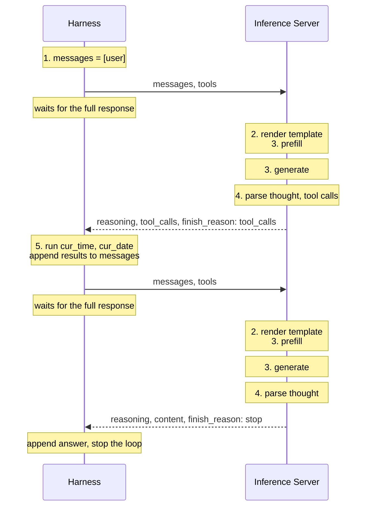
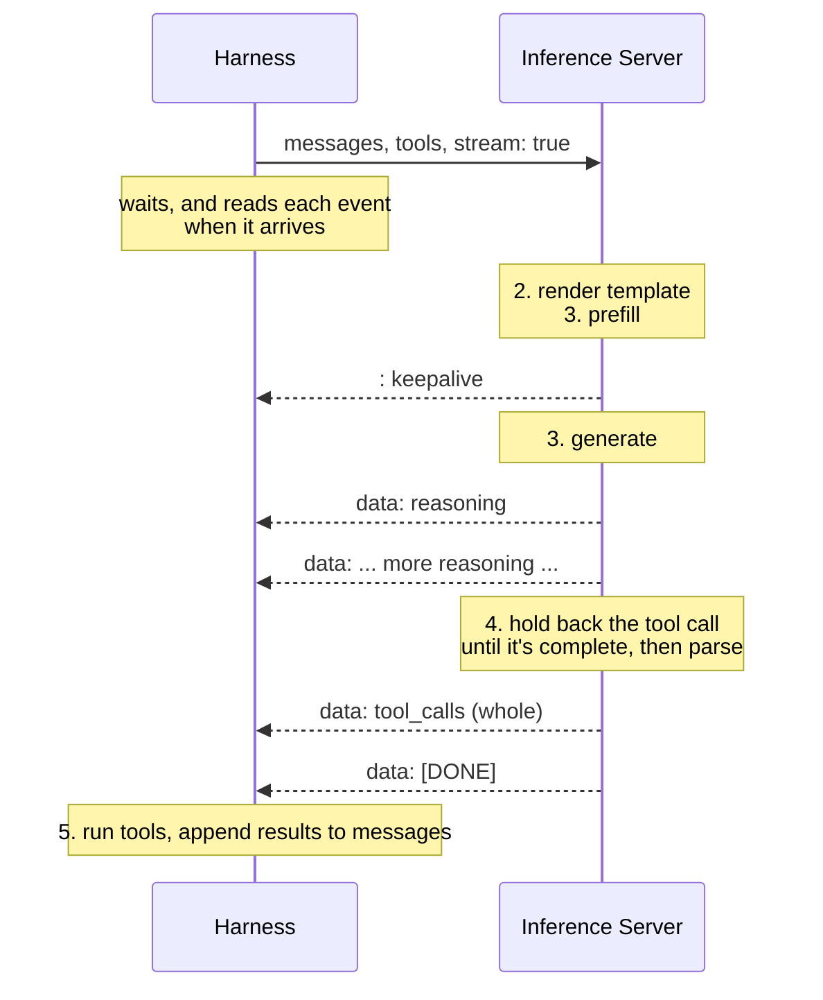

Alright! [Last time](/posts/03-making-agents-work-for-you/tool-calling) we gave our agent it's first tools, `cur_time`
and `cur_date`, parsed the tool calls ourselves, figured out how the template wants the tool responses, and
even came up with a heuristic to measure how good our harness is. I also said the next post will be about
improving the tools and prompts. Well... plans changed. This post takes a small detour from the original track.

> TL;DR: I've started a series of posts where I write an agentic harness from scratch and take you
  through the journey. I'll tell you what challenges I faced and what things I tried in an attempt to solve
  those challenges.

This is the whole series (tentative, not complete yet):

- [First post](/posts/01-making-agents-work-for-you/baby-steps) : Introduction to basic concepts that will be required for this series
- [Second post](/posts/02-making-agents-work-for-you/baby-harness) : Writing a basic harness and watching the agent work, studying the behavior
- [Third post](/posts/03-making-agents-work-for-you/tool-calling) : Get some tools in. Introducing problems and a goal to the agent and
    watching it use the tools to achieve the goal
- This post : Interacting with a remote inference. The original tentative idea was different.
- Next post : Writing tools for a specific task/workflow and watching agent work on it in the loop


I kept the original plan in the previous posts as is (crossed out), so you can see how the trajectory changed.
This was not planned at all, but I think my setup will work much better if only the inference runs on the
inference server, and the harness runs on whatever machine I want.

This is not me copying what others are doing btw, it's just the logical thing to do for my setup. My Mac Mini has
24G of unified memory, shared between CPU and GPU. Whatever tools the agent runs later (compilers, debuggers,
whatever else) will fight with the model for that same memory. Machine starts swapping, overall performnace
goes down, and all that swapping reduces the life of my machine. So the model gets the Mac all to itself.


# Remote Inference

I already introduced the idea of inference in my [first post](/posts/01-making-agents-work-for-you/baby-steps)
in the series.

Usually when you're interacting with an agent, you're closer to the harness than to the inference
server. [claude-code](https://github.com/anthropics/claude-code), [codex](https://github.com/openai/codex), etc... are harnesses but none of these run the actual model
locally, they talk to Anthropic, OpenAI to get the inference capabilities. The tools run on your machine
and the harness comes with batteries included.

That's exactly the split I want. The inference server does only one thing, turn tokens into more tokens.
Everything else, the loop, the tools, the transcripts, the compilers and debuggers my agent will run later,
lives on some other machine. And there are a few more good things that come with this split :

- Loading the model takes time. If I restart my harness, I dont have to wait for the
  model to load again. The server just sits there with the model loaded.
- One model, many harnesses. My bug hunting harness and my news summary harness can both talk to the same
  server.
- I already self host almost everything I use. This just makes the model one more service in my homelab.

btw.. in [I, Robot](https://en.wikipedia.org/wiki/I,_Robot_(film)), the NS-5 be the frontier models and NS-4 be the
open models. This setup is my NS-4. Go watch I, Robot again right now!

# Harness v/s Inference

Before we write any code, let's think about this for a minute. In the [last post](/posts/03-making-agents-work-for-you/tool-calling)
our harness did all of this, in one Python process, on the same machine :

1. Keep a `messages` list
2. Render it into a prompt with `apply_chat_template`
3. Call `generate` and get text back
4. Parse tool calls out of the text with `gemma4.parse_tool_call`
5. Run the tools and attach `tool_responses` back to `messages`

Nobody had to decide who is responsible for what, because there was only one program. Now there are two
programs on two machines, and every step has to belong to one of them.

## Designing The Split

A good way I found to split responsibility is to ask who has the knowledge to do the job.

The inference side knows the model. It has the weights, the tokenizer, the chat template, the special markers
like `<|channel>` and `<|tool_call>` that only make sense for Gemma4, and the KV cache. It knows how many
tokens it read and generated, and why it stopped generating.

The harness knows the task. It knows the goal, which tools exist and how to run them, what the transcript
looks like so far, when to stop the loop, and what to do when something goes wrong. Retry? Tell the model
it made a mistake? Give up?

## Visualizing The Split

With `mlx_lm.server`, steps 2 and 4 move to the inference side, right next to step 3. Here's the date and time
example from the last post (the one we'll run later in this post) as a conversation between the harness and
the server. Two requests, one that ends with tool calls and one that ends with the final answer.



The harness never touches the template, the special markers or the raw generated text. It sends `messages`,
gets back JSON with the thought, the answer and the tool calls already seperated, runs the tools, and sends
`messages` again. Everything model specific happens on the right side of the diagram.

# Start The Engines!!

`mlx_lm.server` comes with the same `mlx-lm` package we installed in the [second post](/posts/02-making-agents-work-for-you/baby-harness).
So on the inference server, inside the same virtual environment :

```bash
source hari.venv/bin/activate
mlx_lm.server --model mlx-community/gemma-4-26B-A4B-it-qat-4bit
```

...and here is the output :

```
.../mlx_lm/server.py:1745: UserWarning: mlx_lm.server is not recommended for production as it only
implements basic security checks.
  warnings.warn(
2026-10-14 20:49:51,226 - INFO - Starting httpd at 127.0.0.1 on port 8080...
```

Keep this warning in mind, we'll come back to it. For now, let's check if the server is alive. On the inference server itself :

```bash
curl localhost:8080/health
{"status": "ok"}
```

Now from the machine that runs the harness :

```bash
curl http://inference:8080/health
curl: (7) Failed to connect to inference port 8080 after 19 ms: Could not connect to server
```

Can you guess why? Let's look at the log line again. `Starting httpd at 127.0.0.1`. The server is only listening
on `127.0.0.1`, the loopback address, which is only reachable from the inference server itself. That's a sane
default btw, a server that nobody else can reach can't be abused by anybody else. To make it reachable, we tell
it which address to listen on :

```bash
mlx_lm.server --model mlx-community/gemma-4-26B-A4B-it-qat-4bit --host 0.0.0.0
```

`0.0.0.0` means _every network interface this machine has_. Now the machine that runs the harness can reach it.


Every network interface means everyone who can reach your inference server can now use your model. There's no
password, no API key, nothing. Remember the warning in the log? Keep reading, there's a whole section on this.


There are a few other endpoints than `/health`. `/v1/models` lists the models the server knows about :

```bash
curl http://inference:8080/v1/models
```

...and here is the response (list cut short) :

```json
{
    "object": "list",
    "data": [
        {
            "id": "mlx-community/gemma-4-26B-A4B-it-qat-4bit",
            "object": "model",
            "created": 1792036271
        },
        ...
    ]
}
```

It doesn't only list the model you started it with, it lists every model sitting in your
Hugging Face cache. Mine had a few more from my experiments.

# Your First Request

The endpoint we really care about is `/v1/chat/completions`. Let's ask the same question we asked in the
[second post](/posts/02-making-agents-work-for-you/baby-harness), with the same token budget of $500$.

```bash
curl http://inference:8080/v1/chat/completions \
  -H "Content-Type: application/json" \
  -d '{
    "model": "mlx-community/gemma-4-26B-A4B-it-qat-4bit",
    "max_tokens": 500,
    "messages": [
      {
        "role": "user",
        "content": "Hey L, do you know gods of death like apples? Tell me which show is this dialogue from."
      }
    ]
  }'
```

...and here is the response (reasoning cut short) :

```json
{
    "id": "chatcmpl-2f7b4fc8-45e8-4287-b67c-256751175dfc",
    "system_fingerprint": "0.32.0-0.32.3-macOS-26.6.1-arm64-arm-64bit-Mach-O-applegpu_g14g",
    "object": "chat.completion",
    "model": "mlx-community/gemma-4-26B-A4B-it-qat-4bit",
    "created": 1792037139,
    "choices": [
        {
            "index": 0,
            "finish_reason": "length",
            "message": {
                "role": "assistant",
                "content": null,
                "reasoning": "\n\n*   Dialogue: \"Hey L, do you know gods of death like apples?\"\n*
                              Question: \"Tell me which show is this dialogue from.\"\n\n ... *
                              Specifically, it's a line spoken by **Ryuk** (the Shinigami/God of Death) to
                              **Light Yagami** (who uses the alias \"Kira,\" but the user says \"L\" - wait,
                              let me re-read).\n\n ... *   The dialogue is definitely from *Death Note"
            }
        }
    ],
    "usage": {
        "prompt_tokens": 37,
        "completion_tokens": 500,
        "total_tokens": 537,
        "prompt_tokens_details": {
            "cached_tokens": 0
        }
    }
}
```

Let's compare this with the output of `mlx_lm.generate` from the second post. Same information, just packaged
differently. Let's go over every field :

- `id` : A unique id for this request. Useful if you're logging requests.
- `system_fingerprint` : The `mlx-lm` version, the OS, and the GPU (`applegpu_g14g` is the M2). If outputs
  suddenly change one day, this is the first thing I'll check.
- `object` : What kind of object this is. A full response is a `chat.completion`. We'll see another kind
  when we get to streaming.
- `model` : The model that generated this.
- `created` : Unix timestamp of when the response was made.
- `choices` : A list, because some servers can generate multiple answers for one request. Here it's always one.
  - `finish_reason` : Why the model stopped. `length` means it ran out of `max_tokens`. Exactly what we saw
    in the second post, but now we dont have to eyeball the output to find out it got cut off.
  - `message.content` : The answer. It's `null`! The model never got to answer.
  - `message.reasoning` : The thought. Wait, where did `<|channel>thought` and `<channel|>` go?
- `usage` : `prompt_tokens` is how many tokens the rendered prompt had, `completion_tokens` how many the model
  generated. `cached_tokens` is how many of the prompt tokens the server didn't have to process again, more
  on that in [KV Cache On The Server](#kv-cache-on-the-server).

## Thought Traces

Remember in the second post, the output had a structure. Thought between `<|channel>thought` and
`<channel|>`, answer after it. We had to split that ourselves with `text.split("<channel|>", 1)`.

The server does that for us now. It knows Gemma4's markers, it watches the generated tokens go through
a small state machine (normal, reasoning, tool call), strips the markers, and puts each piece in it's own
field. Thought goes to `reasoning`, answer goes to `content`.

Let's give it more room and see an actual answer :

```bash
curl http://inference:8080/v1/chat/completions \
  -H "Content-Type: application/json" \
  -d '{
    "model": "mlx-community/gemma-4-26B-A4B-it-qat-4bit",
    "max_tokens": 2000,
    "messages": [
      {
        "role": "user",
        "content": "Hey L, do you know gods of death like apples? Tell me which show is this dialogue from."
      }
    ]
  }'
```

...and here is the response (reasoning truncated) :

```json
{
    "id": "chatcmpl-6d22f34e-3b31-47ee-9838-ba215d6c6805",
    "system_fingerprint": "0.32.0-0.32.3-macOS-26.6.1-arm64-arm-64bit-Mach-O-applegpu_g14g",
    "object": "chat.completion",
    "model": "mlx-community/gemma-4-26B-A4B-it-qat-4bit",
    "created": 1792037169,
    "choices": [
        {
            "index": 0,
            "finish_reason": "stop",
            "message": {
                "role": "assistant",
                "content": "That dialogue is a reference to the anime and manga series **Death Note**.\n\nIn
                            the series, **Ryuk** is a *Shinigami* (a God of Death) who has a famous and
                            intense obsession with **apples**, which he considers his favorite food.",
                "reasoning": "\n\n*   Dialogue: \"Hey L, do you know gods of death like apples?\"\n*
                              Question: \"Tell me which show is this dialogue from.\"\n\n    *   \"Hey L\" ->
                              Refers to a character named \"L\".\n    *   \"gods of death\" -> A key concept
                              in the anime/manga *Death Note*.\n    *   \"apples\" -> A major character
                              trait/obsession of the character Ryuk in *Death Note*.\n ..."
            }
        }
    ],
    "usage": {
        "prompt_tokens": 37,
        "completion_tokens": 674,
        "total_tokens": 711,
        "prompt_tokens_details": {
            "cached_tokens": 36
        }
    }
}
```

Now `finish_reason` is `stop`, meaning the model ended it's turn on it's own.

## Passing Parameters To The Template

In the second post we passed parameters to `apply_chat_template` ourselves, `enable_thinking`,
`add_generation_prompt`, `continue_final_message`, and we even swapped the template with our own. The template
lives on the server now, so how do we pass any of these? Two ways :

- For every request, start the server with `--chat-template-args`, for example
  `--chat-template-args '{"enable_thinking":false}'`
- For a single request, put `chat_template_kwargs` in the request body. If both have the same key, the
  request wins.

```bash
curl http://inference:8080/v1/chat/completions \
  -H "Content-Type: application/json" \
  -d '{
    "model": "mlx-community/gemma-4-26B-A4B-it-qat-4bit",
    "max_tokens": 500,
    "chat_template_kwargs": {"enable_thinking": false},
    "messages": [
      {
        "role": "user",
        "content": "Hey L, do you know gods of death like apples? Tell me which show is this dialogue from."
      }
    ]
  }'
```

...and here is the response :

```json
{
    ...
    "choices": [
        {
            "index": 0,
            "finish_reason": "stop",
            "message": {
                "role": "assistant",
                "content": "That dialogue is from the anime **Death Note**.\n\nIt is spoken by **Ryuk**, the
                            Shinigami (God of Death), who has a well-known obsession with eating apples."
            }
        }
    ],
    "usage": {
        "prompt_tokens": 34,
        "completion_tokens": 40,
        "total_tokens": 74,
        "prompt_tokens_details": {
            "cached_tokens": 2
        }
    }
}
```

No `reasoning` field at all, the model didn't think.

## The Template Parameters That Don't Work

So `enable_thinking` works. What about the other two we played with in the second post? Let's try turning off
`add_generation_prompt` the same way :

```bash
curl -w '\nHTTP %{http_code}\n' http://inference:8080/v1/chat/completions \
  -H "Content-Type: application/json" \
  -d '{
    "model": "mlx-community/gemma-4-26B-A4B-it-qat-4bit",
    "max_tokens": 50,
    "chat_template_kwargs": {"add_generation_prompt": false},
    "messages": [
      {
        "role": "user",
        "content": "Hey L, do you know gods of death like apples? Tell me which show is this dialogue from."
      }
    ]
  }'
```

`-w` tells `curl` to also print the HTTP status code, you'll see why in a moment. And here is the response :

```
{"error": "mlx_lm.tokenizer_utils.TokenizerWrapper.apply_chat_template() got multiple values for keyword argument 'add_generation_prompt'"}
HTTP 404
```

Okay, what about `continue_final_message`? In the second post we used it to make the model continue a message
it already started. So let's start the answer for it and ask it to continue :

```bash
curl -w '\nHTTP %{http_code}\n' http://inference:8080/v1/chat/completions \
  -H "Content-Type: application/json" \
  -d '{
    "model": "mlx-community/gemma-4-26B-A4B-it-qat-4bit",
    "max_tokens": 50,
    "chat_template_kwargs": {"continue_final_message": true},
    "messages": [
      {
        "role": "user",
        "content": "Hey L, do you know gods of death like apples? Tell me which show is this dialogue from."
      },
      {
        "role": "assistant",
        "content": "That dialogue is from"
      }
    ]
  }'
```

...and here is the response :

```
{"error": "continue_final_message and add_generation_prompt are not compatible. Use continue_final_message when you want the model to continue the final message, and add_generation_prompt when you want to add a header that will prompt it to start a new assistant message instead."}
HTTP 404
```

I never even set `add_generation_prompt` this time. And if I set both, `continue_final_message` to `true`
and `add_generation_prompt` to `false`, I get the first error agian, _multiple values for keyword argument_.

Whenever an error says _multiple values_, let's go read the code. Here's how [`mlx_lm.server`](https://github.com/ml-explore/mlx-lm/blob/main/mlx_lm/server.py)
renders the template :

```py
chat_template_args = self.model_provider.cli_args.chat_template_args
if args.chat_template_kwargs:
    chat_template_args = chat_template_args.copy()
    chat_template_args.update(args.chat_template_kwargs)
template_kwargs = dict(
    tools=tools,
    tokenize=True,
    **chat_template_args,
)
prompt = tokenizer.apply_chat_template(
    messages,
    add_generation_prompt=True,
    **template_kwargs,
)
```

There it is. `add_generation_prompt=True` is hardcoded. Whatever we put in `chat_template_kwargs` gets merged
into `template_kwargs`, and that gets unpacked right next to the hardcoded one. So :

- Pass `add_generation_prompt` and python gets it twice. First error.
- Pass `continue_final_message` and the template gets both of them as true, which makes no sense (start a new
  turn _and_ continue the last one?). Second error.
- Pass both, and it's the first error again.

So there's no way to do what we did in the second post from a request. The server always opens a new model
turn, period. The only way around it is changing the server code itself.

And now look at that `HTTP 404`. A 404 means _Not Found_, like I typed the wrong URL. But the URL is perfectly
fine, it's my arguments that are wrong. In the server code, if anything goes wrong while starting the
generation, it doesn't matter what, it just sends a 404 with the error message :

```py
except Exception as e:
    self._set_completion_headers(404)
    self.end_headers()
    self.wfile.write(json.dumps({"error": str(e)}).encode())
    return
```

If your harness only checks the status code, it will think the server or the endpoint is gone, when actually
it just didn't like one paramter. Read the body, not just the status code.

That's a good reason to use an existing, more mature server from the [Other Inference
Servers](#other-inference-servers), or to write a custom one for fun, one that works only for my purpose, for
my harness. More on that in [Writing Custom Inference Server (For
Fun)](#writing-custom-inference-server-for-fun).

# Calling The Tools

Now let's port the harness from the [third post](/posts/03-making-agents-work-for-you/tool-calling).
We still use `transformers` for `get_json_schema`, the harness just doesn't load a model or run inference
anymore. `load` and `generate` from `mlx_lm` are replaced by our own `generate`, which sends the request to the
server, and the server parses the tool calls, so `gemma4.parse_tool_call` is gone too.

```py
#!/usr/bin/env python3

import json
import urllib.request
from datetime import datetime
from transformers.utils import get_json_schema

# where the inference server lives, and which model it should use
URL = "http://inference:8080/v1/chat/completions"
MODEL = "mlx-community/gemma-4-26B-A4B-it-qat-4bit"


def cur_time():
    """
    Get current time
    """
    return str(datetime.now().time())


def cur_date():
    """
    Get current date
    """
    return str(datetime.now().date())


TOOLS = {"cur_time": cur_time, "cur_date": cur_date}


# replaces load and generate from mlx_lm
# we send the messages and the tools, the server renders the template,
# generates, parses the tool calls and sends back JSON
def generate(messages):
    body = json.dumps(
        {
            "model": MODEL,
            "max_tokens": 2560,
            "messages": messages,
            "tools": [get_json_schema(x) for x in list(TOOLS.values())],
        }
    ).encode()
    req = urllib.request.Request(
        URL, data=body, headers={"Content-Type": "application/json"}
    )
    with urllib.request.urlopen(req) as res:
        return json.load(res)


prompt = "What's the current date and time?"
messages = [{"role": "user", "content": prompt}]

# ask current date and time and get first response
response = generate(messages)
message = response["choices"][0]["message"]
messages.append(message)

# the server already parsed the tool calls, make the tool calls and append output
messages.extend(
    {
        "role": "tool",
        "tool_call_id": tool["id"],
        "content": TOOLS[tool["function"]["name"]](**json.loads(tool["function"]["arguments"])),
    }
    for tool in message["tool_calls"]
)

# give it to the agent in new request and get the new output
response = generate(messages)
messages.append(response["choices"][0]["message"])

print(json.dumps(messages, indent=2))
```

Here is the first response from the server :

```json
{
  "id": "chatcmpl-c9befa6c-0951-4094-94a5-e86ddcf696ee",
  ...
  "choices": [
    {
      "index": 0,
      "finish_reason": "tool_calls",
      "message": {
        "role": "assistant",
        "content": null,
        "reasoning": "\nThe user is asking for the current date and time. I should use the `cur_time` and
                      `cur_date` tools to get this information.",
        "tool_calls": [
          {
            "function": {
              "name": "cur_time",
              "arguments": "{}"
            },
            "type": "function",
            "id": "6629ce84-e8f6-40a6-ba87-c72a5ea60945"
          },
          {
            "function": {
              "name": "cur_date",
              "arguments": "{}"
            },
            "type": "function",
            "id": "2d6c41c9-adbb-415e-99c9-1c7c34349e07"
          }
        ]
      }
    }
  ],
  "usage": {
    "prompt_tokens": 73,
    "completion_tokens": 53,
    "total_tokens": 126,
    "prompt_tokens_details": {
      "cached_tokens": 6
    }
  }
}
```

A new `finish_reason`, `tool_calls`. The model stopped becuase it wants us to run something. Compare
`tool_calls` with what `gemma4.parse_tool_call` gave us in the last post :

```
{'name': 'cur_time', 'arguments': {}}
```

Same thing, but now each call also has an `id`, and `arguments` is a JSON _string_, not a dictionary. That's why
the harness does `json.loads(tool["function"]["arguments"])`. And here is the whole transcript at the end :

```json
[
  {
    "role": "user",
    "content": "What's the current date and time?"
  },
  {
    "role": "assistant",
    "content": null,
    "reasoning": "\nThe user is asking for the current date and time. I should use the `cur_time` and
                  `cur_date` tools to get this information.",
    "tool_calls": [
      {
        "function": { "name": "cur_time", "arguments": "{}" },
        "type": "function",
        "id": "6629ce84-e8f6-40a6-ba87-c72a5ea60945"
      },
      {
        "function": { "name": "cur_date", "arguments": "{}" },
        "type": "function",
        "id": "2d6c41c9-adbb-415e-99c9-1c7c34349e07"
      }
    ]
  },
  {
    "role": "tool",
    "tool_call_id": "6629ce84-e8f6-40a6-ba87-c72a5ea60945",
    "content": "21:07:07.426738"
  },
  {
    "role": "tool",
    "tool_call_id": "2d6c41c9-adbb-415e-99c9-1c7c34349e07",
    "content": "2026-10-14"
  },
  {
    "role": "assistant",
    "content": "The current date is October 14, 2026, and the time is 9:07 PM.",
    "reasoning": "\nThe user wants to know the current date and time.\nThe `cur_time` tool returned
                  \"21:07:07.426738\".\nThe `cur_date` tool returned \"2026-10-14\".\nI should combine these
                  into a clear response.\n"
  }
]
```


Tool results now go in with `role: tool`, one message per tool call, and `tool_call_id` says which call this
result belongs to. That's the `elif` case of the template I skipped over in the last post. If you did that
assignment, you already knew this one!


# Everyone Hides Their Failures

In the third post I said I wanted to recover from bad tool calls more elegantly. So let's make a bad tool call
on purpose. I'll turn thinking off (so the model starts the tool call right away) and give it only $4$ tokens,
so it gets cut off right in the middle of the tool call.

```bash
curl http://inference:8080/v1/chat/completions \
  -H "Content-Type: application/json" \
  -d '{
    "model": "mlx-community/gemma-4-26B-A4B-it-qat-4bit",
    "max_tokens": 4,
    "chat_template_kwargs": {"enable_thinking": false},
    "tools": [
      {
        "type": "function",
        "function": {
          "name": "cur_time",
          "description": "Get current time",
          "parameters": {"type": "object", "properties": {}}
        }
      }
    ],
    "messages": [{"role": "user", "content": "What is the current time?"}]
  }'
```

...and here is the response :

```json
{
    ...
    "choices": [
        {
            "index": 0,
            "finish_reason": "length",
            "message": {
                "role": "assistant",
                "content": null
            }
        }
    ],
    ...
}
```

Nothing. No content, no reasoning, no tool calls. Just `length`. What did the model actually write? No
idea! Here is the warning in the server log on the inference server :

```
2026-10-14 21:08:11,953 - WARNING - Failed to parse tool call (ValueError: No function provided.) — tool text
was likely truncated mid-generation.
```

The server tried to parse the tool call, failed, logged a warning _on it's own machine_, and dropped it. In
the server code it's literally a `continue`. My harness, sitting on another machine, never sees the broken
tool call. For the harness it just looks like the model said nothing.

This is fine when the cause is `max_tokens`, because `finish_reason` tells you. It's not fine when the model
writes a malformed tool call in the middle of a long session, which small models do. When the harness and the inference ran in one program, I had the raw text in my hands and
could show it back to the model ("your tool call was broken, here's what you wrote, try again").

And the server clearly knows what happened, it says so in the log! Nothing stops a server
from sending that back to the harness, the raw text, or an error saying the tool call couldn't be parsed, and
letting the harness decide what to do. That's just not what `mlx_lm.server` chose to do, at least at the time of
writing this.

# KV Cache On The Server

Remember when I asked you to compare the timing between two turns, in the assignments of the second post? The
harness we've been writing in this series doesn't reuse the KV cache. Every `generate` call starts with an empty cache, so
every call does the full computation over the whole transcript again, and that gets slower and slower as the
transcript grows. And remember me screaming at my harness for being slow in the first post, untill AI caught me
not using the KV cache? Same story here. Except this time `mlx_lm.server` solves it instantly for us, because it
handles the KV cache for us.

After every request, `mlx_lm.server` keeps the KV cache of what it processed in a _prompt cache_. When a new
request starts the same way as one it has seen before, it reuses that cache and only processes the rest.
`cached_tokens` in `usage` tells you how many tokens it got to skip. An agent loop fits this well, every turn
only adds to the end of the transcript, so the new prompt starts with the old one.

We dont control the cache from the request, but we can shape it with the parameters we pass when we start
the server :

- `--prompt-cache-size` : how many different caches the server keeps, $10$ by default. When a new one doesn't
  fit, the least recently used one goes.
- `--prompt-cache-bytes` : a limit on the total size of those caches. The cache lives in the same unified memory
  as the model, so this is the one to set before your machine starts swapping.
- `--kv-bits` and `--kv-group-size` : quantize the KV cache (remember quantization from the first post?), so a
  longer context fits in the same memory.
- `--quantized-kv-start` : the token position from which the KV cache gets quantized.
- `--prefill-step-size` : how many prompt tokens get processed in one step. When streaming, this is also how
  often the `keepalive` progress comes.

All of these are set once, when the server starts. Want a bigger cache for a long session, or a quantized cache
for a long context? Restart the server, and lose everything it had cached. That's one more reason to use an
existing, more mature server from the [Other Inference Servers](#other-inference-servers) that gives you more
control, or to write a custom one for fun that lets the harness manage the cache the way it needs. More on
writing your own in [Writing Custom Inference Server (For Fun)](#writing-custom-inference-server-for-fun).

# Server-Sent Events

Let's ask for something long. A story about Einstein (yes, again), at least $2000$ words,
thinking off, `max_tokens` set to $3000$.

Nothing comes back untill the whole story is generated. A blinking cursor, then everything at once. With `mlx_lm.generate`
we saw tokens appear as they were generated. Where did that go? The server waits until the whole response
is done, wraps it in JSON and sends it. JSON needs it's closing `}` to be valid, so it can't send half of it.

For a harness that's running unattended, maybe that's fine. But if you're watching your agent, or building a
chat interface, or your harness wants to stop the model early when it starts looping (remember the thought
loops from the first post?), you need tokens as they come. That's what `"stream": true` does.

## Looking At The Raw Stream

```bash
curl -N http://inference:8080/v1/chat/completions \
  -H "Content-Type: application/json" \
  -d '{
    "model": "mlx-community/gemma-4-26B-A4B-it-qat-4bit",
    "max_tokens": 60,
    "stream": true,
    "stream_options": {"include_usage": true},
    "messages": [
      {
        "role": "user",
        "content": "Hey L, do you know gods of death like apples? Which show this is dialogue from."
      }
    ]
  }'
```

`-N` tells `curl` not to buffer the output, so we see it as it arrives.

...and here is the response (only the first few and the last few of the $61$ events, and I broke the long
lines to make them readable, on the wire every event is a single `data:` line) :

```
: keepalive 11/12

: keepalive 12/12

data: {"id": "chatcmpl-a079f9df-...", "object": "chat.completion.chunk", ...,
       "choices": [{"index": 0, "finish_reason": null, "delta": {"role": "assistant", "reasoning": "\n\n"}}]}

data: {"id": "chatcmpl-a079f9df-...", "object": "chat.completion.chunk", ...,
       "choices": [{"index": 0, "finish_reason": null, "delta": {"role": "assistant", "reasoning": "*"}}]}

data: {"id": "chatcmpl-a079f9df-...", "object": "chat.completion.chunk", ...,
       "choices": [{"index": 0, "finish_reason": null, "delta": {"role": "assistant", "reasoning": "   "}}]}

data: {"id": "chatcmpl-a079f9df-...", "object": "chat.completion.chunk", ...,
       "choices": [{"index": 0, "finish_reason": null,
                    "delta": {"role": "assistant", "reasoning": "Dialogue"}}]}

...

data: {"id": "chatcmpl-a079f9df-...", "object": "chat.completion.chunk", ...,
       "choices": [{"index": 0, "finish_reason": null, "delta": {"role": "assistant", "reasoning": "God"}}]}

data: {"id": "chatcmpl-a079f9df-...", "object": "chat.completion.chunk", ...,
       "choices": [{"index": 0, "finish_reason": "length", "delta": {"role": "assistant"}}]}

data: {"id": "chatcmpl-a079f9df-...", "object": "chat.completion", ...,
       "choices": [],
       "usage": {"prompt_tokens": 35, "completion_tokens": 60, "total_tokens": 95,
                 "prompt_tokens_details": {"cached_tokens": 23}}}

data: [DONE]

```

Remember the diagram from [Visualizing The Split](#visualizing-the-split)? Here's the first request of that
date and time example again, this time with `"stream": true` :



Let's compare the two. Before, the server sent one arrow back with everything in it. Now the harness still sends
one request, but the response comes back one piece at a time. Step 3 is not hidden inside the server anymore,
you see it happen piece by piece. And step 4 doesn't happen the same way for everything, the reasoning comes as
it's generated, but the tool call comes in one piece at the end. More on that in a bit.

This format is called Server-Sent Events (SSE). It's a very old and very simple idea, and I think it's worth going
over every piece of it, becuase once you know it you'll start noticing it in a lot of places.

- It's still one HTTP request and one HTTP response. The server just doesn't close the response. It sends
  the headers right away, with `Content-Type: text/event-stream`, and then keeps writing to the same response
  for as long as it wants.
- Every `data:` line is part of the response to the one request the harness sent. The harness just waits, and
  reads each event when it arrives. The connection stays open until `[DONE]`.
- The body is plain text, read line by line.
- A line starting with `data: ` carries the data of an event. Here it's always one JSON object.
- An empty line ends the event. That's why there's a blank line after every `data:` line.
- A line starting with `:` is a comment. A client must ignore it. The server uses comments as a
  _keepalive_, to tell everything between the client and the server (proxies, load balancers, the client's
  own timeout) that the connection is not dead, it's just thinking. `mlx_lm.server` also puts the prompt
  processing progress in it, `11/12` means $11$ of the $12$ uncached tokens are processed.
- `data: [DONE]` is not SSE, it's a convention of this API. It's not JSON, so dont try to parse it, just stop.

Inside the JSON, a few things changed compared to the full response :

- `object` is `chat.completion.chunk` instead of `chat.completion`.
- `message` became `delta`. A delta is _what's new since the last event_, not the whole message. You build the
  full message yourself by joining the deltas. Here every delta was a piece of `reasoning`.
- `finish_reason` is `null` until the very last chunk.
- `usage` comes as it's own event at the end, with an empty `choices`, and only if you ask for it with
  `stream_options`. Otherwise you dont get token counts at all when streaming.

## Streaming The Harness

Now let's put this into our harness. Only `generate` changes. It asks for `"stream": true`, reads the response
line by line, skips empty lines and comments, strips `data: `, and stops at `[DONE]`. Every piece of `reasoning`
and `content` gets printed as it arrives, and added to the message we build. Tool calls get added the same way.

```py
#!/usr/bin/env python3

import json
import urllib.request
from datetime import datetime
from transformers.utils import get_json_schema

# where the inference server lives, and which model it should use
URL = "http://inference:8080/v1/chat/completions"
MODEL = "mlx-community/gemma-4-26B-A4B-it-qat-4bit"


def cur_time():
    """
    Get current time
    """
    return str(datetime.now().time())


def cur_date():
    """
    Get current date
    """
    return str(datetime.now().date())


TOOLS = {"cur_time": cur_time, "cur_date": cur_date}


# same as before, but the response now comes in pieces
# we print every piece as it arrives, and build the message from the pieces
def generate(messages):
    body = json.dumps(
        {
            "model": MODEL,
            "max_tokens": 2560,
            "stream": True,
            "messages": messages,
            "tools": [get_json_schema(x) for x in list(TOOLS.values())],
        }
    ).encode()
    req = urllib.request.Request(
        URL, data=body, headers={"Content-Type": "application/json"}
    )

    message = {"role": "assistant", "content": "", "reasoning": "", "tool_calls": []}
    with urllib.request.urlopen(req) as res:
        for line in res:
            line = line.decode().rstrip("\n")

            # an empty line ends an event, a line starting with ':' is a comment
            if not line or line.startswith(":"):
                continue

            # everything else starts with 'data: '
            data = line.removeprefix("data: ")
            if data == "[DONE]":
                break

            delta = json.loads(data)["choices"][0]["delta"]
            for key in ["reasoning", "content"]:
                if piece := delta.get(key):
                    print(piece, end="", flush=True)
                    message[key] += piece
            message["tool_calls"] += delta.get("tool_calls", [])

    print()
    return message


prompt = "What's the current date and time?"
messages = [{"role": "user", "content": prompt}]

# ask current date and time and get first response
message = generate(messages)
messages.append(message)

# the server already parsed the tool calls, make the tool calls and append output
messages.extend(
    {
        "role": "tool",
        "tool_call_id": tool["id"],
        "content": TOOLS[tool["function"]["name"]](**json.loads(tool["function"]["arguments"])),
    }
    for tool in message["tool_calls"]
)

# give it to the agent in new request and get the new output
messages.append(generate(messages))

print(json.dumps(messages, indent=2))
```

...and here is the output (transcript truncated) :

```

The user is asking for the current date and time. I should use the `cur_time` and `cur_date` tools to get
this information.

The user wants to know the current date and time.
The `cur_time` tool returned "23:11:33.688026".
The `cur_date` tool returned "2026-10-14".
I should combine these into a clear answer.
The current date is October 14, 2026, and the time is 11:11 PM.
[
  ...
  {
    "role": "assistant",
    "content": "",
    "reasoning": "\nThe user is asking for the current date and time. I should use the `cur_time` and
                  `cur_date` tools to get this information.",
    "tool_calls": [
      {
        "function": { "name": "cur_time", "arguments": "{}" },
        "type": "function",
        "id": "8ad3722d-3ba3-4527-ab0a-d84f025da2cf",
        "index": 0
      },
      {
        "function": { "name": "cur_date", "arguments": "{}" },
        "type": "function",
        "id": "7317addb-b820-4d2f-9788-965f533c6fdf",
        "index": 1
      }
    ]
  },
  ...
]
```

The reasoning and the answer show up while the model is writing them. The rest
works like before, except that we build the assistant message ourselves now. `content` is an empty string
instead of `null`, and every tool call has an `index`. The server takes it as it is, and the second request
still gets it's answer.


This parser is good enough for this server, but not for every SSE stream. An event can have multiple `data:`
lines, there are also `event:`, `id:` and `retry:` fields, and the server is free to put a space after
the colon or not. The spec is linked in the resources.


## Tool Calls In A Stream

What happens with tool calls in a stream? Is the model going to send me `cur_` and then `time` and then `{}`?
I asked the `What is the current time?` question with the `cur_time` tool and `"stream": true`. After $25$
`reasoning` chunks, here is the rest of the response (long lines broken for readability) :

```
data: {...,
       "choices": [{"index": 0, "finish_reason": null,
                    "delta": {"role": "assistant",
                              "tool_calls": [{"function": {"name": "cur_time", "arguments": "{}"},
                                              "type": "function",
                                              "id": "b30c619a-e5d9-4873-ba63-6be0d02494b7",
                                              "index": 0}]}}]}

data: {..., "choices": [{"index": 0, "finish_reason": "tool_calls", "delta": {"role": "assistant"}}]}

data: [DONE]
```

The whole tool call arrived in one chunk. The server holds back everything while the model is inside the
tool call, and only sends it once the call is complete and parsed. There's also an `index` now, so if several
tool calls come in, you know which is which. Other servers do send tool call arguments in pieces though, so
dont count on this if you want your harness to work with them.

# Security Concerns

Let's come back to that warning :

```
mlx_lm.server is not recommended for production as it only implements basic security checks.
```

Splitting the harness and the inference over a network opens up a few things that weren't there when it was
all one program on one machine.

With `--host 0.0.0.0`, anyone who can reach port $8080$ on my inference server can use my model, my electricity, my
GPU, as much as they want. There's no API key, no username, nothing. They can also see every model in my
Hugging Face cache with `/v1/models`.

It's not only machines either. The server allows requests from any website (`Access-Control-Allow-Origin: *`),
so a web page open in a browser on the same network can talk to it too.

Everything we send is plain HTTP. The system prompt, the user's messages, the model's reasoning and answers,
all of it. And think about what the harness sends in every request, the whole transcript, _including every
tool result_. Right now our tools return the date and time. In the next post they'll return file contents,
command outputs, maybe things you never wanted to leave your machine. Anyone who can watch the network between
the harness and the server can read all of it.

The prompt cache is shared by everyone who talks to the server. It's looked up only
by the tokens, not by who sent them. So if someone else sends a prompt that starts the same way as mine, the server
reuses my cache for them, and tells them so in `cached_tokens`. That number is enough to guess, piece by piece,
what someone else's prompt starts with, a system prompt for example.

Let's look at our harness again :

```py
TOOLS[tool["function"]["name"]](**json.loads(tool["function"]["arguments"]))
```

It runs whatever tool the response asks for, with whatever arguments the response has. In the third post that
response came from our own process. Now it comes over the network. Remember the prompt injection part from the
last post? That was about what the model _reads_. This is about the response itself. Anyone who can change the
response on it's way back, or anyone who controls the server, can make the harness run any tool it has. With a
date and time tool that's harmless. With a tool that runs shell commands, it's definately not.

So, never let the harness or the server face a network you dont trust. Simple as that.

# Other Inference Servers

I've only used `mlx_lm.server` because I have a Mac. But did you notice that none of the requests I sent had
anything Gemma or MLX specific in them? `messages`, `tools`, `tool_calls`, `stream`, `finish_reason`, `usage`.
That's because `mlx_lm.server` speaks the same dialect as OpenAI's API, and so does pretty much every
inference server out there. In the second post I asked, _does your harness work without changing code for
different model families?_ With a local harness, no, you need a different tool parser for every family.
With a server, mostly yes. The server deals with the family, you deal with JSON.

Funny thing, in the first post I told you I had tried LM Studio and llama.cpp before and it didn't stick, because
I never looked at how they worked. Well, now I've looked inside one. Maybe they deserve another shot.

Here are the ones I'd look at, depending on what you have :

- [llama.cpp](https://github.com/ggml-org/llama.cpp) comes with `llama-server`. Runs GGUF models on almost
  anything, CPU, NVIDIA, AMD, Apple Silicon. This is the one I'd start with on a machine that isn't a Mac.
- [Ollama](https://ollama.com) and [LM Studio](https://lmstudio.ai) are the friendlier ones. Download a model
  with a click or a command, and they give you an OpenAI compatible server. LM Studio can also run MLX models on a Mac.
- [vLLM](https://github.com/vllm-project/vllm) is the one people run in production on big NVIDIA (and AMD) GPUs. It's built
  around PagedAttention, which I linked in the first post. It's made to serve many users at once.
- [SGLang](https://github.com/sgl-project/sglang) is in the same league as vLLM. It's interesting for us
  because of RadixAttention, a smarter version of the prefix cache we saw in this post.
- [exo](https://github.com/exo-explore/exo) splits one model across multiple machines. If you have more than one Mac
  lying around, this one is for you.

And if you're on a Mac like me, there are servers made only for Apple Silicon, built on MLX, that do more with
the KV cache than `mlx_lm.server` does :

- [vllm-mlx](https://github.com/waybarrios/vllm-mlx) brings vLLM style features to MLX, continuous batching,
  a paged KV cache and prefix caching.
- [oMLX](https://github.com/jundot/omlx) keeps the hot part of the KV cache in memory, and moves the rest to the
  SSD when memory fills up.
- [mlx-openai-server](https://github.com/cubist38/mlx-openai-server) is a simpler one, an OpenAI compatible
  server for MLX models, text and vision.

All of these have their own flags, their own defaults, their own template quirks, and their own way of
handling (or not handling) broken tool calls. Same API on the outside doesn't mean they behave the same on the
inside.

# AI Proxies

Since the whole thing works by send json and get json, anything that can take that json, pass it along somewhere
else, and hand the json back can sit inbetween. That's a proxy. Your harness sends the same json it always sends,
the proxy forwards it to one or many inference servers, and the harness doesn't even know there's something in
the middle.

- [OpenRouter](https://openrouter.ai) is a hosted one. One API key, one endpoint, hundreds of models from lots of
  providers, frontier and open models both. It also handles fallbacks when a provider is down. To point our
  harness at it, change `URL` to `https://openrouter.ai/api/v1/chat/completions`, change `MODEL` to whatever model
  you want, and add an `Authorization: Bearer <key>` header, because unlike my inference server, OpenRouter does
  want to know who you are. That's it. Want to see how a frontier model does on the same goal? Change one string.
- [LiteLLM](https://docs.litellm.ai/docs/simple_proxy) is the self hosted one. You run the gateway yourself, and it
  gives you one OpenAI compatible endpoint in front of 100+ providers, and that includes your own `mlx_lm.server`.
  Remember the [Security Concerns](#security-concerns), no API key, no username, nothing? LiteLLM gives every user
  or project it's own virtual key, with budgets and rate limits, and logs every request. Put it in front of
  `mlx_lm.server` and you get the things `mlx_lm.server` doesn't do.
- [Cursor](https://cursor.com) is not really a proxy, it's an editor, a harness. But it's interesting here because
  it works like one. Even when you give it your own API key, [all requests are routed through Cursor's
  servers](https://cursor.com/help/models-and-usage/api-keys) for final prompt building. Your prompt, your code,
  your tool results, all of it goes to Cursor's servers first, and only then to the provider. And if you want to
  point it at a model running in your home, that model has to be reachable from Cursor's servers, not just from
  your laptop.

A proxy is one more program between your harness and the model. Remember [Everyone Hides Their
Failures](#everyone-hides-their-failures)? Now there are two places where a broken tool call can disappear. Some
proxies also translate between the APIs of different providers, OpenAI's format to Anthropic's and back, and every
translation is one more place where something can get lost or changed. And everything in [Security
Concerns](#security-concerns) goes for the proxy too. It sees the whole transcript, every request, including every
tool result. With a hosted proxy, that's someone else's machine.

# Writing Custom Inference Server (For Fun)

And if none of these servers handle things the way you want, or you just want to have some fun, write your own. Sounds
like a big job, right? But let's look at what a chat server actually does with a request :

- Load the model once, with `load`. We did this in the [second post](/posts/02-making-agents-work-for-you/baby-harness).
- Render `messages` and `tools` into a prompt with `apply_chat_template`. Second and [third post](/posts/03-making-agents-work-for-you/tool-calling).
- Generate with `generate`. Second post.
- Split the thought from the answer at `<channel|>`. Second post.
- Parse the tool calls with `gemma4.parse_tool_call`. Third post.
- Take the tool results from the next request and put them where the template expects them. Third post.

We have already written every single one of these. The only thing missing is the part that takes JSON from an
HTTP request and sends JSON back in the response. `mlx_lm.server` itself is built on `http.server` from the Python
standard library, so even that part doesn't need anything extra.

And when it's your server, you decide what happens when a tool call doesn't parse. Send the raw text back,
send an error, add your own `finish_reason`, whatever your harness needs to decide what to do next.

Sounds simple enough on paper. It didn't go that simple for me though. When I was writing my custom harness,
I asked AI to write a custom HTTP server for my inference. It didn't work out well in the end because of so many
broken parts in the code, hidden, waiting to be triggered. Soon after that I realized how important context
management is (remember [Keeping It Clean](/posts/01-making-agents-work-for-you/baby-steps/#keeping-it-clean)
from the first post?). Keeping a context dedicated to one single task is the only way you can get best quality
output on the same task.

Thats why I'd rather you either write it custom, on your own, or use a clean context and know before hand what you
want, or, you just be smart and use a mature existing inference server that works for you!

# Assignments

Write your own chat server. You already have every piece of it from the last two posts, the only new part is
taking JSON in and sending JSON back. Then decide for yourself what your server should do when a tool call
doesn't parse. And make it accept `add_generation_prompt` and `continue_final_message`, so you can do from a
request what we did in the second post.

Play with the parameters we pass to the server. Take `--prompt-cache-size`, `--prompt-cache-bytes` or `--kv-bits`,
try a few values, run the harness, and watch `cached_tokens` and the memory on the inference machine. Then do the
same with `chat_template_kwargs`. What changes? What doesn't?

Run two harnesses against the same server at the same time. Does each one get slower? Does the server still
reuse the cache for each of them?

Point your harness at another server from the list, `llama-server` for example. Does it work without changing
code? Does the stream look the same?

All this time we've been running mlx, ever thought about using some other inference engine? Now that we have a
harness written seperately from inference, what about adapting your harness to work with different inference
engines?

Have fun!

# Conclusion

The model now lives on the inference server and the harness can live anywhere. We got a lot for free, the template,
the reasoning split, the tool parsing, a prompt cache that survives across requests, streaming. But
the harness now depends on the choices the server makes. `mlx_lm.server` drops broken tool calls instead of
telling us about them, and it doesn't let us touch `add_generation_prompt` at all.

Next post, we finally give the agent some real tools for a real task and watch it work in the loop.

See you there! Bye!!

# Resources

- [mlx-lm server source](https://github.com/ml-explore/mlx-lm/blob/main/mlx_lm/server.py)
- [mlx-lm server documentation](https://github.com/ml-explore/mlx-lm/blob/main/mlx_lm/SERVER.md)
- [OpenAI Chat Completions API reference](https://platform.openai.com/docs/api-reference/chat)
- [Server-sent events, HTML Living Standard](https://html.spec.whatwg.org/multipage/server-sent-events.html)
- [Using server-sent events](https://developer.mozilla.org/en-US/docs/Web/API/Server-sent_events/Using_server-sent_events) - MDN
- [Gemma 4 Model Card](https://ai.google.dev/gemma/docs/core/model_card_4) - Google
- [llama.cpp server](https://github.com/ggml-org/llama.cpp/tree/master/tools/server)
- [vLLM OpenAI compatible server](https://docs.vllm.ai/en/latest/serving/openai_compatible_server.html)
- [SGLang : Efficient Execution of Structured Language Model Programs](https://arxiv.org/abs/2312.07104) - Zheng et al., 2023 (RadixAttention)
- [Efficient Memory Management for LLM Serving with PagedAttention](https://arxiv.org/abs/2309.06180) - Kwon et al., 2023
- [Ollama OpenAI compatibility](https://docs.ollama.com/api/openai-compatibility)
- [LM Studio OpenAI compatibility](https://lmstudio.ai/docs/app/api/endpoints/openai)
- [exo](https://github.com/exo-explore/exo)
- [Cross-Origin Resource Sharing (CORS)](https://developer.mozilla.org/en-US/docs/Web/HTTP/Guides/CORS) - MDN
- [OpenRouter Quickstart](https://openrouter.ai/docs/quickstart)
- [LiteLLM AI Gateway](https://docs.litellm.ai/docs/simple_proxy)
- [Cursor : API Keys](https://cursor.com/help/models-and-usage/api-keys)

# AI Disclosure

This post was written with the help of an AI. The diagrams in this post were made by the AI, with clear
instructions and review from me (the author).

If you wanna talk about any of this, or say hi, reach me at hi@brightprogrammer.in, I'll try my best to reach back.
